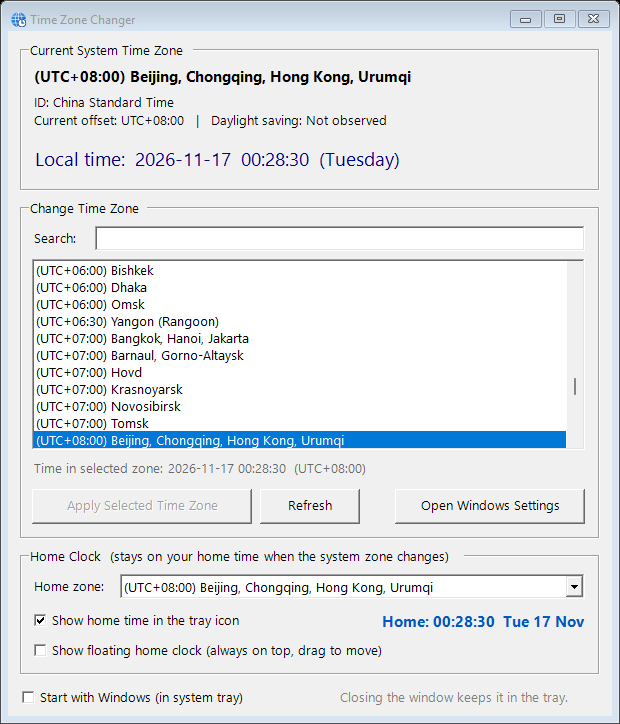
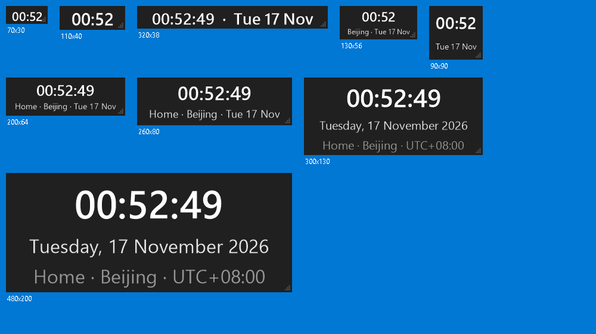

<p align="center">
  
</p>

<h1 align="center">Time Zone Changer</h1>

<p align="center">
  A small Windows 11 app for viewing and switching the system time zone, with a system tray icon and a resizable floating "home clock" that keeps showing your home time.
</p>

<p align="center">
  
</p>

## Features

- **See the current time zone**: name, ID, UTC offset, daylight saving status and a live clock.
- **Change it quickly**: search all Windows time zones (by city, ID or offset such as `+09`), see the time in the selected zone, then apply it.
- **System tray icon**
  - Right-click to switch between your 8 most recent zones, or back to your home zone.
  - Closing the window keeps the app running in the tray.
  - Notifications when the zone changes.
- **Home clock**: pick a "home" time zone that doesn't change when the system zone does.
  - The tray icon shows the home time as live digits.
  - Hovering over it shows both the system time and the home time.
  - 
- **Floating home clock**: optional, always on top, drag to move, drag the edges to resize.
  - The text changes with the window size so it stays readable, from a tiny `09:41` up to the time, the full date and the time zone details.
  - 
- **Start with Windows**: starts in the tray at logon through a Task Scheduler task with admin rights, so there's no UAC prompt at logon.
- **Single exe**, no installer, no dependencies. It uses the .NET Framework 4.8 included with Windows 10/11.
- **Stays in sync** when the time zone is changed somewhere else, for example in Windows Settings.

## Download

Get `TimeZoneChanger.exe` from the [Releases](../../releases) page and run it. It asks for administrator rights (UAC) because changing the system time zone needs them.

## Build from source

You don't need Visual Studio. The build uses the C# compiler that comes with Windows:

```powershell
powershell -ExecutionPolicy Bypass -File .\build.ps1
```

This creates `TimeZoneChanger.exe` in the repository root. If `src\app.ico` is missing, the script generates it first. Add `-Version 1.2.3` to stamp a version number into the exe.

## Releasing

Releases are built automatically by GitHub Actions ([`.github/workflows/release.yml`](.github/workflows/release.yml)). Push a tag that starts with `v`:

```powershell
git tag v1.2.0
git push origin v1.2.0
```

The workflow then:
- builds the exe on `windows-latest` with the tag's version stamped into it,
- creates a GitHub Release with `TimeZoneChanger.exe`, a SHA-256 checksum and automatically generated release notes.

Tags with a hyphen, such as `v1.3.0-beta`, are published as pre-releases. You can also start the workflow by hand from the Actions tab for a test build, which is uploaded as an artifact without creating a release.

## Usage tips

| Action | How |
|---|---|
| Open the main window | Left-click the tray icon, or double-click the floating clock |
| Quick-switch time zone | Right-click the tray icon, then pick a recent zone |
| Move / resize the floating clock | Drag it to move; drag an edge or corner to resize |
| Floating clock options | Right-click it: Open, Reset size, Hide |
| Quit | Right-click the tray icon, then **Exit** |

**Showing only your home time on the taskbar:** turn off the Windows clock under *Settings → Time & language → Date & time → Show time and date in the System tray* (on recent Windows 11 builds), then turn on the floating home clock and place it on or near the taskbar.

> Windows has one system time zone, and the taskbar clock always follows it. That's why this app has a separate home clock.

## How it works

- The time zone is changed with the built-in `tzutil.exe /s "<Zone ID>"`.
- Settings are stored in `%APPDATA%\TimeZoneChanger\` (`settings.ini`, `recent.txt`).
- "Start with Windows" creates a scheduled task named **TimeZoneChanger**. It runs at logon with the highest privileges, has no time limit, and keeps running on battery.
- The app manifest requests `requireAdministrator`.

## Project layout

```
src/TimeZoneChanger.cs   App source (WinForms, C# 5 / .NET Framework 4.x)
src/app.manifest         Requests administrator rights
src/app.ico              App icon (generated by build.ps1)
build.ps1                Build script (uses the C# compiler included with Windows)
.github/workflows/       CI: build and publish a release when a v* tag is pushed
legacy/                  Original PowerShell version (TimeZoneChanger.ps1 + .bat launcher)
docs/                    Screenshots
```

## Requirements

- Windows 10 or 11
- .NET Framework 4.8 (included with Windows)
- Administrator rights
